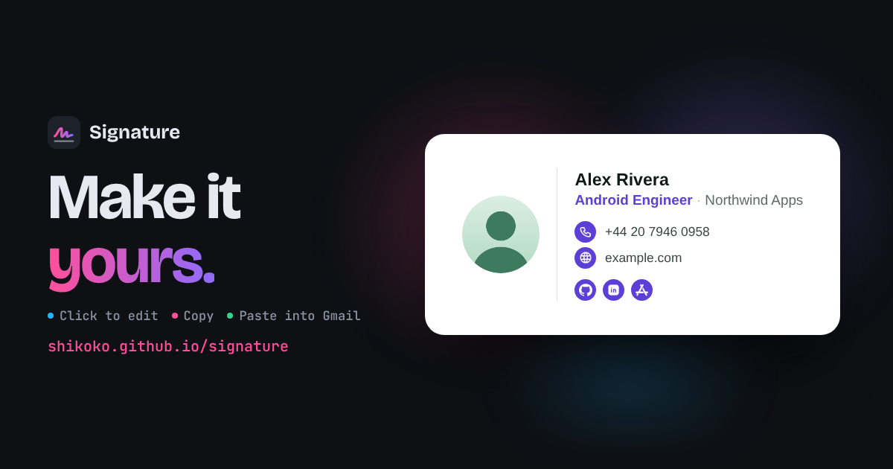

# Signature

Make a Gmail signature by editing it in place, then paste it into Gmail.

**Live:** https://shikoko.github.io/signature/



## What it does

- **Edit the signature itself.** Click any text on the large preview to type over it, including labels such as "Mobile". Click a link or the photo to change its address.
- **Add what you need:** phone, email, website, address; GitHub, LinkedIn, X, Bluesky, Mastodon, Instagram, YouTube, Dribbble, Medium, Stack Overflow; App Store and Google Play; a booking link or any other link; pronouns, a tagline and small print.
- **Arrange it.** Drag lines and links to reorder them, or use the arrows that appear on hover. The Layout panel offers side by side, stacked, two columns or compact; photo shape and size; contact on one line or one per line; labels as words, icons or none; links as words, icons or both; icons in brand colours, grey or white on the accent colour; a divider; and the order of the tagline, contact and links.
- **Two versions.** Copy the full signature for new emails and a short one for replies. Both are copied as rich text, ready for Gmail's signature box.
- **Checks as you go:** example details still in use, photo links that don't load, the accent colour's contrast against white, and Gmail's 10,000-character limit.
- **Private.** Details are saved in the browser's `localStorage` and sent nowhere.

## How the copied signature is built

Gmail removes stylesheets, web fonts, SVG and embedded `data:` images from signatures, so the copied HTML uses only tables, inline styles and Helvetica or Arial. Icons are PNG files hosted on this site under `icons/v1/`; see [icons/README.md](icons/README.md) for where they come from, their licences, and why those files must never change. Outlook and some company mail servers block images, so the Words options for labels and links are the safest choice when that matters.

## Files

- `index.html`, `styles.css`: the page
- `signature.js`: the signature's details and the renderer that produces the copied HTML, the email preview and the editable poster from the same code
- `app.js`: editing, the hover bar, the pop-ups, the Layout panel and copying
- `icons/v1/`: the icons the copied signatures link to
- `tools/icons/`: the script that draws the icons
- `assets/`: the favicon, the example photo and the social preview image

## Running it locally

It's a static site with no build step:

```bash
python3 -m http.server 8000
```

Then open http://localhost:8000.

Made by [Bogdan Roatis](https://shikoko.github.io/).
